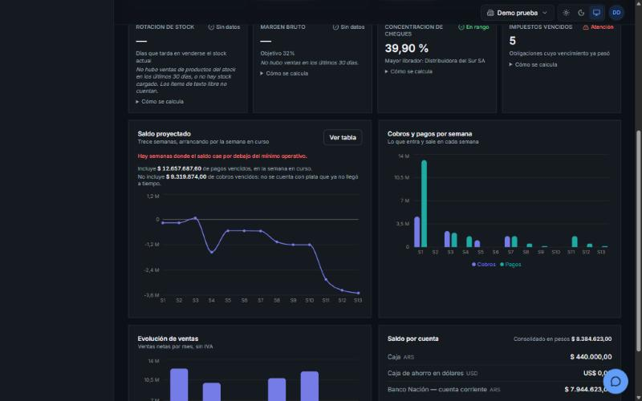
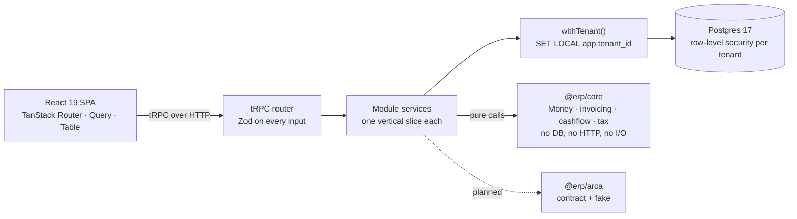

# ERP PyME

A multi-tenant ERP for small Argentine businesses: invoicing, receivables and
payables, treasury, inventory and taxes — built so that every financial rule
lives in one pure package, and no query can reach another company's data even
if someone writes it wrong.

[](https://github.com/franfocaraccio/ERPSoftware/actions/workflows/ci.yml)
[](LICENSE)


**[Live demo](https://erp-software-seven.vercel.app)** — loaded with invented
data. Credentials are not published yet; ask if you want a look.



<sub>Demo data. The figures are invented and the companies do not exist.</sub>

## What problem it solves

A small Argentine company runs on a spreadsheet until the spreadsheet stops
answering the only question that matters: *will there be money in the account
three weeks from now?* Answering it means knowing what has been invoiced, what
was actually collected, which cheques clear when, what the bank already
charged, and what the tax calendar will take out. Those live in five different
places, and none of them agree.

This ERP puts them in one place and projects thirteen weeks forward from it. It
is built for the person who signs the cheques, not for an accounting
department: the vocabulary is the one used in an Argentine small business, and
the numbers come with a "how this is calculated" link next to them.

## Features

| Module | What it does |
| --- | --- |
| **Customers / Suppliers** | Accounts, tax category, credit limit, running balance, current account with ageing |
| **Sales documents** | Invoices, credit and debit notes, with letter (A/B/C/E) derived from the parties' tax categories, VAT broken down by rate, and a state machine where only a draft is editable |
| **Purchase documents** | Supplier invoices in their own table, with items that feed stock and cost |
| **Collections & payments** | Receipts applied to specific documents, partial applications, what is still open |
| **Treasury** | Accounts in ARS and USD, movements, cheques with their own lifecycle, and **bank reconciliation from the bank's own spreadsheet** |
| **Inventory** | Stock moved by documents rather than typed in, with **weighted-average cost** recalculated on each purchase |
| **Taxes** | VAT position, withholdings, a calendar of obligations and what is already overdue |
| **Results** | Monthly profit and loss by category, period comparison, recurring items |
| **Dashboard** | Liquidity, DSO, DPO, cheque concentration, margin, and a **thirteen-week cash projection** |
| **Document reading** | A supplier invoice as PDF or photo, or a bank statement as a spreadsheet, read into a pre-filled form — see below |
| **AI assistant** | Answers questions about the company's own data, read-only, by calling the app's own endpoints |
| **Team** | Roles, invitations, read-only links scoped to specific modules |
| **Audit log** | Every operation that moves a balance, stock or a tax leaves a record, written in the same transaction |

### Reading documents instead of typing them

Two places where the data already exists somewhere and retyping it is the
actual work:

**Supplier invoices and sales invoices** arrive as a PDF or a photo. A model
reads them into a pre-filled form — and only reads: it copies the values as
printed, and the code converts them, decides the letter, and recomputes the
totals. If what the paper says does not add up, the form says so instead of
silently fixing it.

**Bank statements** arrive as a spreadsheet. The reconciliation screen matches
each line against what is already loaded, proposes what to create, and refuses
to guess when two movements could both be the one. The running balance printed
on every line is used as a check on the reading itself: if a number is
misread, the screen says **which line** broke the chain rather than loading
the wrong figure.
([`conciliacion.ts`](packages/core/src/treasury/conciliacion.ts))

## Architecture



Five packages: `core` (pure domain), `backend` (Express 5 + tRPC 11 + Drizzle +
BetterAuth), `frontend` (Vite SPA), `design-system` (shadcn/ui over Base UI +
Tailwind v4) and `arca` (the electronic-invoicing boundary).

## Engineering highlights

**Money is never a `number`.** Every amount is a `Money` value object over
`decimal.js`, carrying its currency; `numeric` in Postgres becomes a string at
the tRPC edge and a `Money` in the domain. Mixing ARS and USD throws rather
than producing a plausible wrong total.
([`money.ts`](packages/core/src/money/money.ts))

**Tenant isolation is enforced by Postgres, and the test suite proves it.**
Every query goes through `withTenant`, which opens a transaction and sets
`app.tenant_id`; RLS policies read it. The guarantee is not that the code is
careful — it is that **CI runs the tests as a role that cannot bypass RLS**, so
a query that escapes the wrapper fails the build rather than quietly returning
another company's rows.
([`tenant-db.ts`](packages/backend/src/db/tenant-db.ts),
[`ci.yml`](.github/workflows/ci.yml))

**No financial formula outside `core`.** If a calculation appears in a router,
a component or a query, it is in the wrong place. `core` imports nothing — no
database, no HTTP, no framework — and its tests are written before the
implementation. That is what makes a rule like weighted-average cost testable
as arithmetic instead of as an integration.
([`costo.ts`](packages/core/src/stock/costo.ts))

**Migrations are hand-written, idempotent, and never applied by the container
that serves traffic.** Applying one needs the owner role, which can bypass RLS
and therefore read every tenant's data; that credential exists only inside a CI
job, and the image ships without `drizzle-kit`. Production migrations are a
separate manual workflow that requires typing a confirmation phrase. The
backend verifies at startup that the database is not behind the code, and
refuses to boot if it is.
([`DEPLOYMENT.md`](docs/DEPLOYMENT.md),
[`migraciones.ts`](packages/backend/src/db/migraciones.ts))

**The AI assistant cannot invent a number.** It has no SQL, no write access and
no arithmetic of its own. Each tool calls one of the app's existing read
endpoints through a tRPC caller built from the asker's session, so it inherits
every access rule instead of copying them — a read-only link sees only its
modules through the chat too. Totals and percentages come already computed by
`core`. A test compares the tool list against every read endpoint in the
router, so a new module cannot quietly become visible to the assistant without
someone deciding.
([`herramientas.ts`](packages/backend/src/modules/asistente/herramientas.ts))

**Electronic invoicing is designed, not implemented, and the repository says
so.** `packages/arca` holds `IFacturacionElectronica` and a fake that enforces
the rules that matter — gapless numbering, idempotent retries, a total that
must equal net plus VAT. The emitting logic can be written and tested in full
against it, which is where the expensive bugs are: a duplicate fiscal document
gets explained to the tax authority, not fixed with a migration.
([`packages/arca/README.md`](packages/arca/README.md))

**A document with a CAE is immutable** once the integration exists; corrections
happen only through a credit or debit note. Every operation that moves a
balance, stock or a tax writes to the audit log in the same transaction as the
operation itself, so the two cannot diverge.
([`auditar.ts`](packages/backend/src/db/auditar.ts))

## Testing

715 tests across 68 files, in one `pnpm test`.

- **`core` is tested as arithmetic**, test-first: cash projection, ageing,
  weighted-average cost, VAT position, document letters, state transitions,
  the reconciliation matcher.
- **Backend services run against a real Postgres**, never a mocked Drizzle —
  in CI an ephemeral service container, locally the Docker one. Isolation
  between tests comes from RLS itself: each test creates its own organization,
  so Testcontainers is unnecessary.
- **The role used in tests cannot bypass RLS**, which turns tenant isolation
  from a convention into something the suite enforces.
- **Migrations are applied from scratch on every CI run**, so the chain —
  including the RLS policies and the grants — is verified exactly as it will
  run against the real database.

## Quick start

Needs Docker Desktop running and `pnpm install` done once.

```bash
docker compose up -d   # Postgres 17 on localhost:5432
pnpm dev               # backend on 3001, frontend on 5173, both hot-reloading
```

The app is at **http://localhost:5173**.

On a fresh database:

```bash
cd packages/backend && pnpm db:migrate   # apply pending migrations
cd packages/backend && pnpm db:seed      # platform admin + a test company
```

The seed is idempotent and prints its credentials when it finishes.
`packages/backend/scripts/datos-demo.sql` loads a company with six months of
invented movements — set the email at the top to your own account first.

### When something will not start

- **`error during connect: ... dockerDesktopLinuxEngine`** — Docker Desktop is
  closed. Open it, wait for the icon to settle (~40 s), then
  `docker compose up -d`.
- **The backend starts and dies** — almost always the database.
  `docker compose ps` should say `running`; if the container is up but
  refusing connections, `docker compose exec postgres pg_isready -U erp -d erp`.
- **`EADDRINUSE`** — an old `node` is holding 5173 or 3001. In PowerShell:
  `Get-NetTCPConnection -State Listen -LocalPort 5173,3001`, then
  `Stop-Process -Id <pid> -Force`.
- **The app loads but shows no data** — migrations have not run, or the backend
  is down. Check `/health`.

## AI-assisted development

This repository is built to be worked on with coding agents, and the setup is
part of it rather than a side note.

- **[`CLAUDE.md`](CLAUDE.md)** holds the rules that are not negotiable — money
  is never a `number`, every query goes through `withTenant`, no financial
  logic outside `core`, Zod at every boundary — plus the modelling decisions
  already made, so they do not get re-litigated every session.
- **[`AGENTS.md`](AGENTS.md)** carries the domain summary: what a *comprobante*
  is, how letters work, which states a document can be in.
- **`.agents/skills/`** has one file per technology (tRPC, Drizzle,
  BetterAuth, shadcn, the Argentine tax domain) with the patterns this
  codebase uses, so an agent writes the house style instead of a generic one.
- **`.claude/commands/`** holds the repetitive operations: check the database,
  scaffold a vertical slice, run the full verification.

The commit history is written to be read: each message says what changed and
**why**, including the mistakes and what they cost.

## Roadmap

- **Electronic invoicing against ARCA** — WSAA and WSFEv1 adapters behind the
  existing interface, against the homologation environment first, with
  recorded responses as fixtures.
- **Background jobs** — the projection recalculation, KPI snapshots and
  due-date alerts are designed as jobs but still run on request; the hosting
  decision that keeps a job runner possible is already made and documented.
- **End-to-end tests** over the main flow, in CI.
- **A public demo environment** separate from everything else, reset on a
  schedule.

## Why the code is in Spanish

Identifiers, tables and columns are in Spanish: `comprobante`, `retencion`,
`monotributo`, `cuenta_corriente`. This is deliberate. The domain is Argentine
tax law, and those words have exact meanings that their English approximations
lose — a *comprobante* is not a "receipt", a *monotributista* is not a
"freelancer", and a *nota de crédito* is a legal instrument with rules, not a
refund. Translating them would mean every conversation with the person who
uses the software requires a glossary, and every mistranslation becomes a bug
in a fiscal calculation.

Commit messages, pull requests and anything written on GitHub are in English.
The product documentation is in Spanish, because the people who read it are.

## License

MIT — see [LICENSE](LICENSE).
