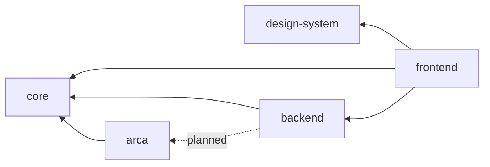

# Architecture

How the pieces fit, and what each one is allowed to do. The decisions behind
these shapes, with their trade-offs, are one file each in [`adr/`](adr/).

## Packages

```
@erp/core            pure domain — Money, invoicing, cash flow, tax, stock
@erp/arca            the electronic-invoicing boundary: contract + fake
@erp/backend         Express 5 + tRPC 11 + Drizzle + BetterAuth
@erp/design-system   shadcn/ui over Base UI + Tailwind v4
@erp/frontend        Vite SPA, React 19, TanStack Router/Query/Form/Table
```

Dependencies only ever point one way:



`core` depends on nothing but `decimal.js`. It has no database client, no HTTP
client, no framework, and no clock it did not receive as an argument — which
is what makes its tests arithmetic rather than integration. The frontend
depends on `backend` for **types only**: tRPC's inference gives the client the
router's signature without a generated schema, and nothing from the server
runtime is bundled.

## The life of a request

A customer list, end to end.

1. **The component** calls the tRPC client through TanStack Query. The payload
   is typed from the server's router; a field the backend does not accept does
   not compile.
2. **Express** receives it at `/trpc`. CORS is restricted to the configured
   frontend origin.
3. **`createContext`** resolves the session from the request's cookies through
   BetterAuth, and builds a `Sesion`: the user, the **active organization**,
   the role in it, whether they are a platform admin, and — if the caller came
   in through a read-only link — the list of modules that link may see.
4. **`tenantProcedure`** refuses anything without an active organization, and
   injects `tenantId` **from the session**. A tenant id in the request body is
   never read; there is nowhere to put one. For a read-only link, the same
   middleware rejects paths outside the link's scope, once, instead of each
   router checking.
5. **`escrituraProcedure`** / **`administradorProcedure`** narrow further by
   role, so a `solo_lectura` member cannot reach a mutation.
6. **Zod** parses the input. Every `.input()` has a schema; money arrives as a
   decimal string, never a float.
7. **The service** does the work. It converts strings to `Money`, calls
   `@erp/core` for anything that is a calculation, and reaches the database
   only through `withTenant`.
8. **`withTenant`** opens a transaction and runs
   `set_config('app.tenant_id', …, true)`. Everything inside sees only this
   organization's rows.
9. **Postgres** applies the RLS policy on every table touched.
10. **The response** goes back as JSON with amounts as strings, and TanStack
    Query caches it.

Four routes do **not** go through tRPC, because they move files or streams:
reading a document from a PDF or image, uploading a bank statement, generating
a PDF report, and the assistant's chat stream. Each one resolves the session
and checks the role itself, before accepting the upload — so nobody can push
five megabytes into the server's memory unauthenticated.

## Multi-tenancy

One organization is one tenant. A person can belong to several, which is the
real case of an accountant serving more than one company, so the tenant is a
property of the *session*, not of the user.

Isolation is enforced in **three places that do not depend on each other**:

**The session decides.** `tenantId` comes from BetterAuth's
`activeOrganizationId`. No endpoint accepts it as a parameter.

**The wrapper declares it.** `withTenant` is the only way business code gets a
database handle, and it sets `app.tenant_id` inside the transaction, so the
connection returns clean to the pool.

**Postgres enforces it.** Every business table has RLS enabled with `FORCE`
(so it applies even to the table owner) and one policy comparing `tenant_id`
against `current_setting('app.tenant_id', true)`. The `true` matters: with no
`SET LOCAL` the setting is missing, the comparison is against `NULL`, and the
query returns nothing. The failure mode of forgetting the wrapper is *no
rows*, never *another company's rows*.

The application connects as `erp_app`, a role with no `BYPASSRLS` and no table
ownership. It cannot update or delete `audit_log` — that grant is revoked, so
the log is insert-only from the application's side.

### The gap a foreign key leaves

Postgres checks foreign keys **without applying RLS**. So a payload carrying
another company's `clienteId` passes the constraint: the row is invisible to
you, but you can hang your rows off it. `exigirPropios` closes that — it
re-reads the ids inside the transaction, where RLS applies, and rejects
anything it cannot see. Every service that accepts an id from the client calls
it.

### Read-only links

A link for an accountant or an investor creates a **synthetic session** with
role `solo_lectura` and an optional list of modules. There is no second
permission system: every read procedure works untouched, and every write is
refused by the same rule that already refuses a read-only member. Two
implementations of permissions would eventually disagree.

## Authentication

BetterAuth, with the `organization`, `admin`, `twoFactor` and `magicLink`
plugins. Public sign-up is off; people arrive by invitation.

Two role systems that do not mix:

- **In an organization**: `administrador`, `escritura_lectura`,
  `solo_lectura`. These decide what you can do with a company's data.
- **On the platform**: the operators of the SaaS. A platform admin creates
  organizations and invites each one's first administrator, and **by product
  decision cannot see a company's data** — which is why the platform
  procedures do not derive from `tenantProcedure`.

## Background jobs

Designed, not implemented. There is no job runner and no `src/jobs/`; the
projection recalculation, KPI snapshots and due-date alerts run on request
today.

The hosting decision that keeps them possible is already made and enforced:
the backend is a long-running container with scale-to-zero off, rather than
functions. See [ADR 0010](adr/0010-long-running-container.md).

## Where the money lives

A single path, with one conversion at each end:

```
numeric(14,2) in Postgres
  → string at the Drizzle boundary
    → Money (decimal.js + currency) in services and core
      → string again over tRPC
        → formatted for display in the frontend
```

No amount is ever a JavaScript `number`. Arithmetic on two different
currencies throws instead of producing a plausible wrong total.

## Testing

- **`core`**: pure functions, tests written first, no database.
- **Backend services**: against a real Postgres — an ephemeral service
  container in CI, the Docker one locally. Never a mocked Drizzle, because the
  thing most worth testing is the behaviour of RLS and the constraints.
- **Isolation between tests** comes from RLS itself: each test creates its own
  organization, so tests can share a database without a reset between them.
- **CI runs the suite as `erp_app`**, the role that cannot bypass RLS. A query
  that escaped `withTenant` returns nothing and the test fails, which turns the
  rule from a convention into something the build enforces.
- **Migrations are applied from scratch on every CI run**, so the whole
  chain — policies, grants, constraints — is verified as it will run against
  the real database.
